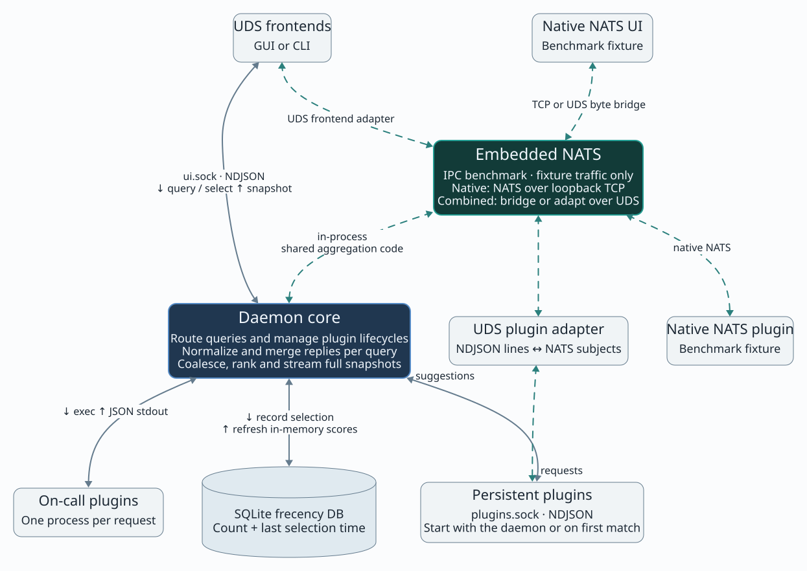

# TarraGon

A highly extensible automation and interaction framework with a language-agnostic plugin system. Built for speed and responsiveness, Tarragon can power anything from command launchers to custom user interfaces. Similar in spirit to macOS Spotlight, Alfred, or dmenu, but designed around a lightweight daemon–plugin architecture that makes it far more extensible and performant.

---

## Core Purpose

- **Primary**: Provide a fast, lightweight core that aggregates and routes requests/responses between plugins and external frontends (CLI, GUI, or custom).
- **Secondary**: Enable easy plugin development in any language through a well-defined IPC protocol (Unix Domain Sockets + NDJSON), supporting rich use-cases like:
  - application launching (one of the original use cases)
  - calculations and unit conversions
  - web/API integrations
  - clipboard or system utilities
  - custom UI components

Plugins can be invoked directly or contextually, and can expose commands, values, or data streams. Prefixes (e.g., `@search`) are optional hints for targeting specific plugins.

---

## Core Architecture

The running daemon uses Unix domain sockets (UDS). A frontend attaches to `ui.sock`; persistent plugins connect to `plugins.sock`. Both sockets carry newline-delimited JSON (NDJSON). On-call plugins instead receive a command-line invocation and return JSON on stdout.



**Solid lines** trace the running daemon. **Dashed lines** trace the IPC benchmark: fixtures take the place of the UI and plugins, and the benchmark runs the same aggregation code in its own process.

### How a suggestion reaches the UI

1. **Dispatch.** The [daemon router](internal/daemon/ui_server.go) acknowledges the query with a `query_id` and publishes an initial snapshot with the target plugins marked `pending`. A matching prefix selects one plugin and is stripped before dispatch. An unprefixed query fans out to eligible general-suggestion plugins.
2. **Gather.** As each plugin replies, the [query store](internal/daemon/aggregate.go) normalizes its JSON into result items and replaces that plugin’s previous batch for the same `query_id`. Other plugins’ items stay in the snapshot. The daemon tracks each target as `pending`, `done`, `empty`, or `error`.
3. **Publish.** One publisher per query combines replies that arrive while it is busy, ranks the accumulated items, and queues a full `update` for each connected UI. The frontend base64-decodes the [snapshot payload](docs/ui.md#message-shapes) and replaces its displayed list for that `query_id`. The first plugin’s suggestions can appear while other plugins are still pending.

**Frecency and ranking.** On `select`, the daemon asynchronously increments the selection count and records the last selection time for the `(plugin ID, result ID)` pair in SQLite. The file defaults to `$XDG_STATE_HOME/tarragon/tarragon.db` (normally `~/.local/state/tarragon/tarragon.db`); `db_path` overrides it.

At startup and after a selection write, the daemon [computes frecency](internal/db/db.go) as `selection count × exp(−0.1 × days since last selection)` and refreshes an in-memory cache. Ranking reads the cache on each snapshot. With the default `frecency_weight` of `0.3`, the final score is `0.7 × plugin score + 0.3 × cached frecency`.

### UDS, NATS and combined transports

The [IPC benchmark](#plugin-benchmarking) measures two connections: **plugin → benchmark core** carries a suggestion; **benchmark core → UI** carries a ranked snapshot. Its query store is transient and never opens the user’s frecency DB.

- **Direct UDS (`uds`):** the plugin writes a response as one NDJSON line. The core reads it directly and writes the cumulative update to the UI’s Unix socket.
- **Native NATS (`nats-tcp`):** the plugin publishes JSON on `bench.<plugin>.out` over loopback TCP. The embedded Core NATS broker delivers it to the benchmark core’s in-process subscription. After aggregation, the core publishes to `bench.ui.in`, which the UI subscribes to. Queries and plugin requests travel the other way on `bench.ui.out` and `bench.<plugin>.in`.
- **Combined (UDS + NATS):** `nats-uds-bridge` carries native NATS protocol bytes over a Unix socket and forwards them unchanged to the broker’s in-process connection. `uds-adapter` lets a peer keep speaking NDJSON: it publishes one NATS message per socket line and restores the newline in the reverse direction. With `--matrix`, each connection independently uses `nats-tcp`, `nats-uds-bridge`, or `uds-adapter`: nine broker-backed pairings plus the separate `uds`/`uds` baseline.

To regenerate the SVG locally, edit the [diagram source](docs/diagrams/architecture.d2) and run `just diagram` with the [D2 CLI](https://d2lang.com/tour/install/) installed. The source selects the Dagre layout.

---

## Features

### Application Launcher
- Provided by the bundled `desktop_files` plugin, which parses `.desktop` files to find and launch installed applications.
- Fuzzy search with user-configurable scoring.
- Frecency-based sorting (frequency x recency).
- Optional icon display (depending on UI backend).
- Launched applications are detached from the plugin process and remain running across Tarragon daemon restarts.

### Hyprland Windows
- The bundled [`hyprland_windows`](plugins/hyprland_windows/README.md) plugin lists open windows with `@windows`, searchable by title, app, and workspace.
- Focus a window, bring it to the currently focused workspace, close it, or toggle floating mode.
- Install with `just plugin-install hyprland_windows`, then run `tarragon plugin restart hyprland_windows`.

### Plugin Overview
Type `@plugins` to browse plugins, including disabled ones. Filter by name or status with `@plugins calc` or `@plugins disabled`. Each row shows the plugin ID, effective prefix, lifecycle, and connection state. The overview is built into the daemon and uses your configured prefix symbol.

Use **open** to search a plugin by its prefix, **enable** or **disable** to change its setting, and **restart** for persistent plugins. Changes use the same primary TOML overrides as `tarragon plugin config`; higher-priority drop-ins still apply. An on-demand plugin restarts on its next matching query.

### Plugin System
- **Integrated Suggestions**: Seamlessly blends suggestions from eligible plugins, including bundled plugins for installed applications and other local tasks.
- **Language Agnostic**: Plugins are external executables or scripts.
- **Persistent Processes & IPC**: For responsiveness, plugins providing real-time suggestions typically run as persistent processes managed by the launcher daemon, communicating via efficient IPC (Unix Domain Sockets + NDJSON). TCP-related config exists as a future-facing placeholder, but the current daemon starts Unix socket IPC only. This avoids per-keystroke lag.
- **Plugin Lifecycle Modes**: Plugins declare their required lifecycle:
    - `daemon`: Runs persistently alongside the launcher daemon (e.g., clipboard manager).
    - `on_demand_persistent`: Started when first needed for a query and kept running afterward.
    - `on_call`: Executed per request (ephemeral process lifecycle).
- **Fan-Out/Gather for Suggestions**: Input is broadcast to eligible plugins concurrently. Results are gathered asynchronously and displayed.
- **Dispatch Controls**: `require_prefix` gates prefix-only plugins, while `provides_general_suggestions` is the general-suggestion eligibility contract for global/unprefixed fan-out.
- **Optional Prefixes**: Prefixes (e.g., `@search`) can still force explicit dispatch to a specific plugin. Plugins declare a bare token and the leading symbol comes from the `prefix_symbol` config option, so it can be changed globally. Any query beginning with that symbol is treated as an explicit routing attempt, so partial or unknown prefixes do not fan out to general plugins.
- **Graceful Shutdown**: Plugins are stopped with `SIGTERM` and only killed if they overrun `plugin_stop_timeout` (default `5s`), so they can flush state and close sockets.
- **Live Restart**: `tarragon plugin restart [plugin-id]` re-reads manifests and bounces plugin processes without restarting the daemon.

### Plugin Benchmarking
Benchmarks run from a source checkout; they are not included in the installed `tarragon` binary.

- `just bench` connects to a running daemon like an external frontend, sends queries through the UI socket, and prints plugin latency results as a table.
- `just bench ipc` runs a separate suggestion-delivery experiment. It starts its own core, persistent fixture plugin processes, and headless UI. No running daemon or installed plugins are needed.
- `just bench ipc --matrix --samples 2000 --warmup 200 --rounds 3` measures the [direct, native NATS, and combined transport paths](#uds-nats-and-combined-transports).
- For congestion, try `just bench ipc --plugins 50 --burst 8 --samples 80 --warmup 16 --rounds 3`. Each plugin returns one small suggestion per query. The UI sends each burst back-to-back, then waits for every plugin's suggestion for every query before starting the next burst. Use `--burst 1` at the same plugin count as a control. Both flags default to 1.
- The table reports mean/p50/p95/p99 in microseconds for plugin encode to core decode, aggregation (including contention), outbound update to UI decode, and end to end. The UI times the first appearance of each `(query, plugin)` in cumulative snapshots. `Query->first` and `Query->all` start at UI query send; `Queries/s` measures completed queries over the elapsed UI measurement window. Startup, warmup, and rendering are excluded. A missing or mismatched suggestion fails the run.

### Plugin Installation & Security
- **Bundled plugin sources**: First-party bundled plugins live in `plugins/`.
- **Template plugin sources**: Authoring templates live separately in `plugin_templates/` so examples are not installed by bundled-plugin recipes.
- **Location**: Plugins reside in `~/.local/lib/tarragon/plugins/`.
- **Install Sources**:
    - `tarragon plugin install <git-url>` for plugin Git repositories with `plugin.toml` and a Makefile.
    - `tarragon plugin enable <name>` for system binaries exposing `tarragon manifest`.
- **Build Standard**: Plugins requiring compilation must include a `Makefile` providing standardized targets:
    - `make check-deps`: Verifies necessary build tools are present. The launcher can use this to inform the user about requirements.
    - `make install`: Builds the plugin and places artifacts correctly.
- **Entrypoint Resolution**:
    - Relative `entrypoint` values are resolved from the plugin directory.
    - Absolute `entrypoint` values are executed directly (used by system-enabled plugins).
- **User Responsibility**: Users should inspect the `Makefile` of third-party plugins before installation to understand the build process. The launcher may facilitate checking dependencies but relies on the user to vet plugin sources.

---

## Configuration

Tarragon reads its primary config from
`$XDG_CONFIG_HOME/tarragon/tarragon.toml` (normally
`~/.config/tarragon/tarragon.toml`). Use `--config-dir` to select a different
directory.

Optional local or packaged overrides belong in `tarragon.d/*.toml` beside the
primary file:

```text
~/.config/tarragon/
|-- tarragon.toml
`-- tarragon.d/
    |-- 10-host.toml
    `-- 90-local.toml
```

Drop-ins are merged in filename order. Later files override earlier files,
including individual keys in nested plugin sections. Files in `tarragon.d`
that do not end in `.toml` are ignored.

The complete precedence order, from lowest to highest, is:

1. `tarragon.toml`
2. `tarragon.d/*.toml` in lexical filename order
3. Environment variables such as `RESULT_ORDERING` and
   `PLUGINS_CALCULATOR_ENABLED`
4. Explicitly supplied command-line flags

Daemon reload and restart requests re-read the complete stack.

## Plugin Configuration

See [docs/plugins.md](docs/plugins.md).

## Contributing

Contributions are VERY welcome! See [https://github.com/mithrel-dots/TarraGon/blob/master/CONTRIBUTING.md](CONTRIBUTING.md) for guidelines. Running pre-commit locally helps keep builds green and diffs clean <3.

### Development TODO

Moved to GitHub issue: Roadmap — https://github.com/mithrel-dots/TarraGon/issues/4

## Shell Completions

Generate a completion script for one shell to stdout and redirect it to the location used by your shell.

```bash
tarragon completion generate zsh > ~/.zsh/completions/_tarragon
```

Other examples:

```bash
tarragon completion generate bash > ~/.local/share/bash-completion/completions/tarragon
tarragon completion generate fish > ~/.config/fish/completions/tarragon.fish
tarragon completion generate powershell > tarragon.ps1
```
